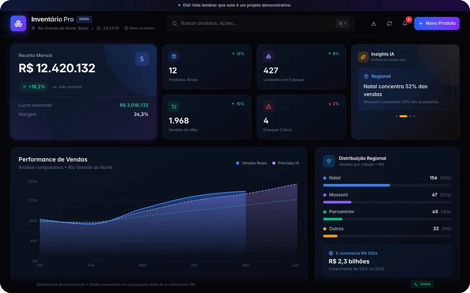
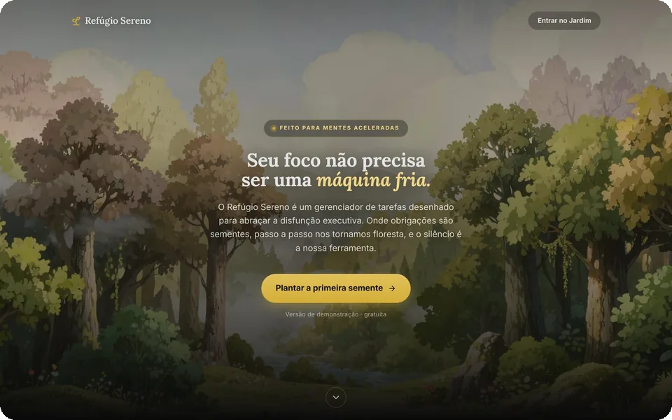
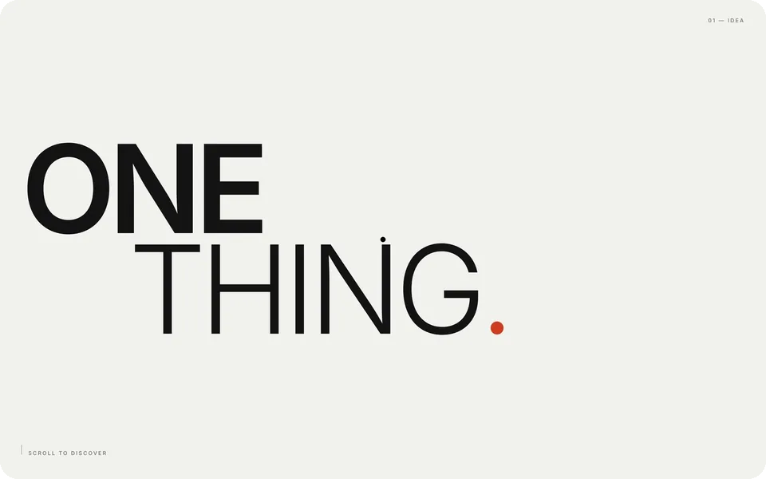
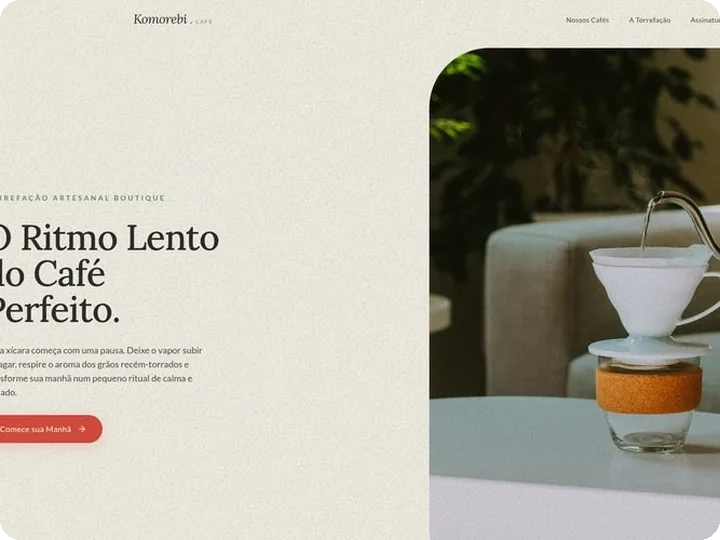
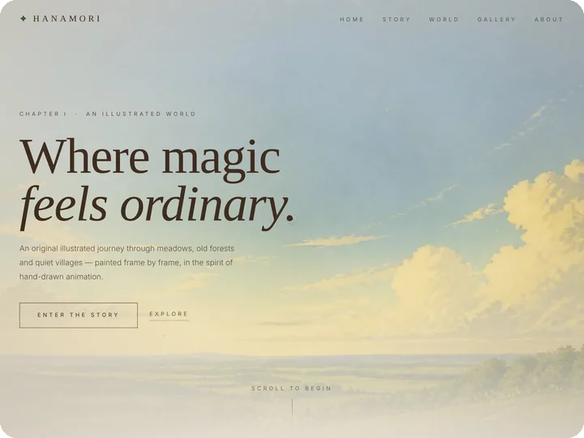
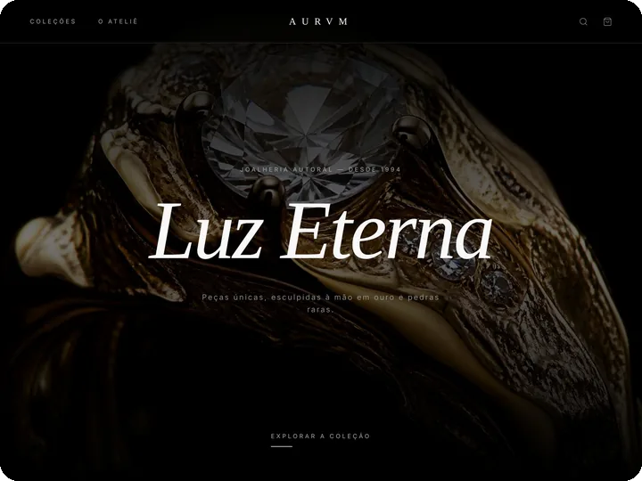
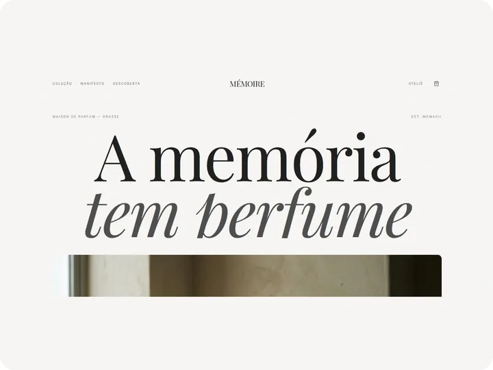

<!-- Perfil de Leonilson Souza — mesmo visual do portfólio: preto e branco, Space Grotesk, estrelas.
     As artes ficam em /assets e trocam sozinhas entre tema escuro e claro do GitHub. -->

<a href="https://mrleorobot.github.io/mrleorobotPOAntigo/">
  <picture>
    <source media="(prefers-color-scheme: dark)" srcset="./assets/hero-dark.svg">
    <source media="(prefers-color-scheme: light)" srcset="./assets/hero-light.svg">
    
  </picture>
</a>

  

Sou de **Natal, RN**. Trabalho entre o design e o código: desenho a interface, cuido do movimento e entrego o front-end funcionando. Gosto de páginas com acabamento de estúdio, que continuam claras, acessíveis e rápidas no celular.

 

<picture>
  <source media="(prefers-color-scheme: dark)" srcset="./assets/sec-cases-dark.svg">
  <source media="(prefers-color-scheme: light)" srcset="./assets/sec-cases-light.svg">
  
</picture>

<table>
  <tr>
    <td width="52%" valign="middle">
      
    </td>
    <td valign="middle">
      <code>CASE · 01</code>
      <h3>Dashboard de Inventário</h3>
      <b>DESAFIO</b> 
      Transformar dados operacionais dispersos em uma visão rápida para tomada de decisão.  
      <b>ENTREGA</b> 
      Cadastro com validação, dados salvos no navegador, ordenação, desfazer exclusão, alertas de estoque e exportação em CSV, Excel e PDF.  
      <code>Next.js</code> <code>TypeScript</code> <code>Framer Motion</code>  
      <a href="https://dashboard-de-inventario.vercel.app/"><b>Abrir projeto →</b></a>
    </td>
  </tr>
  <tr>
    <td width="52%" valign="middle">
      
    </td>
    <td valign="middle">
      <code>CASE · 02</code>
      <h3>Refúgio Sereno</h3>
      <b>DESAFIO</b> 
      Organizar tarefas sem transformar a interface em mais uma fonte de distração para mentes neurodivergentes.  
      <b>ENTREGA</b> 
      Gerenciador de tarefas com temas que acompanham a hora do dia, caderno de campo, sons ambientes e IA que quebra tarefas grandes em passos pequenos.  
      <code>React</code> <code>Firebase</code> <code>Gemini API</code>  
      <a href="https://refugiosereno.vercel.app/"><b>Abrir projeto →</b></a>
    </td>
  </tr>
  <tr>
    <td width="52%" valign="middle">
      
    </td>
    <td valign="middle">
      <code>CASE · 03</code>
      <h3>ONE THING</h3>
      <b>DESAFIO</b> 
      Criar presença visual forte com poucos elementos, sem depender de excesso de conteúdo.  
      <b>ENTREGA</b> 
      Página de uma ideia só, com transições ligadas à rolagem, cursor personalizado e microinterações com física de mola.  
      <code>React</code> <code>TypeScript</code> <code>Motion</code>  
      <a href="https://one-thing-alive.vercel.app/"><b>Abrir projeto →</b></a>
    </td>
  </tr>
</table>

 

<picture>
  <source media="(prefers-color-scheme: dark)" srcset="./assets/sec-projetos-dark.svg">
  <source media="(prefers-color-scheme: light)" srcset="./assets/sec-projetos-light.svg">
  
</picture>

<table>
  <tr>
    <td width="50%" valign="top">
      
      <h3>Komorebi</h3>
      Marca conceitual de café com narrativa visual atmosférica. 
      <code>React</code> <code>Tailwind CSS</code> <code>Framer Motion</code>
    </td>
    <td width="50%" valign="top">
      
      <h3>Hanamori</h3>
      Landing page ilustrada em camadas, no espírito da animação tradicional. 
      <code>React</code> <code>TypeScript</code> <code>Tailwind CSS</code>
    </td>
  </tr>
  <tr>
    <td width="50%" valign="top">
      
      <h3>AURVM</h3>
      E-commerce conceitual de joalheria autoral, com carrinho e página por peça. 
      <code>React</code> <code>TypeScript</code> <code>Motion</code>
    </td>
    <td width="50%" valign="top">
      
      <h3>MÉMOIRE</h3>
      Perfumaria autoral com uma narrativa visual para cada fragrância. 
      <code>React</code> <code>Tailwind CSS</code> <code>Framer Motion</code>
    </td>
  </tr>
</table>

 

<picture>
  <source media="(prefers-color-scheme: dark)" srcset="./assets/sec-stack-dark.svg">
  <source media="(prefers-color-scheme: light)" srcset="./assets/sec-stack-light.svg">
  
</picture>

<picture>
  <source media="(prefers-color-scheme: dark)" srcset="./assets/stack-dark.svg">
  <source media="(prefers-color-scheme: light)" srcset="./assets/stack-light.svg">
  
</picture>

 

<picture>
  <source media="(prefers-color-scheme: dark)" srcset="./assets/sec-contato-dark.svg">
  <source media="(prefers-color-scheme: light)" srcset="./assets/sec-contato-light.svg">
  
</picture>

Tem um projeto, uma vaga ou uma ideia? Respondo rápido.

<a href="mailto:leodsouza.lds@gmail.com"><picture><source media="(prefers-color-scheme: dark)" srcset="./assets/btn-email-dark.svg"><source media="(prefers-color-scheme: light)" srcset="./assets/btn-email-light.svg"></picture></a>&nbsp;
<a href="https://www.linkedin.com/in/leonilsonsouza/"><picture><source media="(prefers-color-scheme: dark)" srcset="./assets/btn-linkedin-dark.svg"><source media="(prefers-color-scheme: light)" srcset="./assets/btn-linkedin-light.svg"></picture></a>&nbsp;
<a href="https://mrleorobot.github.io/mrleorobotPOAntigo/"><picture><source media="(prefers-color-scheme: dark)" srcset="./assets/btn-portfolio-dark.svg"><source media="(prefers-color-scheme: light)" srcset="./assets/btn-portfolio-light.svg"></picture></a>

 

<code>LEONILSON SOUZA · NATAL, RN — BRASIL · MMXXVI</code>
